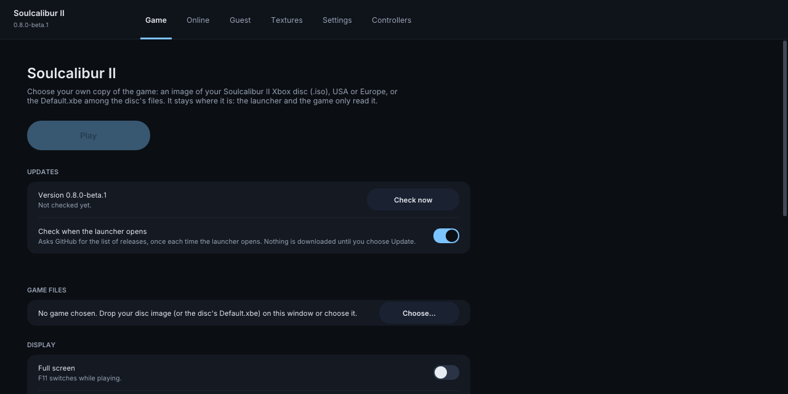
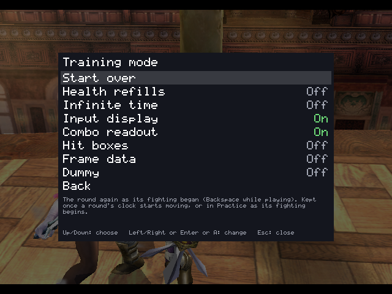

# Playing

Everything a player meets: the launcher, the controls, the in-game menu, training, the free camera, the guests and
online play.

## The launcher

The launcher is where the game is set up and started. Its pages:

- **Game**: your Soulcalibur II (USA) Xbox disc image (`.iso`), or the `Default.xbe` among the disc's files with
  `root.olk`, `movie.afs` and `bgm.afs` beside it. It is checked against the release this port is made from
  ("verified") and only ever read. Below it: full screen, widescreen, the free camera and starting muted; at the top,
  the version and updates.
- **Online**: host, join with a code, your name, the waiting room and the lobby's open matches.
- **Guest**: your GameCube and/or PlayStation 2 disc, and the button that builds the guests from them.
- **Textures**: an HD texture pack (below), imported from the folder you unzipped it to.
- **Settings**: what is set before the game starts (the resolution, and the European disc's language), in presets
  (*Original* plays exactly as the Xbox did; *Enhanced* turns on the improvements) or one by one. The other options
  are in the in-game menu.
- **Controllers**: both players' keys and gamepad buttons, and which connected gamepad is which player's
  (Automatic, a player, or Not used).

The launcher checks for new versions when it opens and installs them itself.

To skip the launcher window once your disc is set up, run `soulcalibur2-launcher --play` (or `soulcalibur2` directly, or `soulcalibur2 --disc path/to/game.iso`; run `soulcalibur2 --help` for options).

## Controls

The game's own layout: X horizontal attack, Y vertical attack, B kick, A guard. Any gamepad SDL knows works; the
keyboard's usual keys (Controllers page to change them, player 1 shown):

| Control | Key | Gamepad |
| --- | --- | --- |
| Move | arrows | d-pad |
| X: horizontal attack | A | West (X / Square) |
| Y: vertical attack | S | North (Y / Triangle) |
| B: kick | X | East (B / Circle) |
| A: guard | Z | South (A / Cross) |
| Black, White | W, Q | left and right shoulders |
| Left and right triggers | E, R | triggers |
| Start | Return | Start |

F11 or Alt+Enter switches full screen. Start, A, B, Return or Space skips the logos and the opening movie.

On Android, a touch shows the touch controls: a stick at the left (it comes to where your thumb lands), the four
attack buttons at the right in the Xbox pad's places and colours (B vertical at the top, A horizontal at the left, K
kick at the right, G guard at the bottom) with A+G (a throw, both at once) beside G, Start at the top right and Menu
at the top left. They are player 1's pad,
so the Controllers page's layout applies to them too, and they work the in-game menu (the stick moves, G chooses, K
goes back). They fade after five seconds untouched and go when a key is pressed; a gamepad works beside them.
Android's Back button opens the in-game menu.

## The in-game menu

Esc, F1, Android's Back, or a gamepad's Guide, left stick click, Back or Start and Back together opens it over the
paused game (not during an online match: Esc then asks whether to leave; Esc and Back only when no player has them as
a control). The same close it from any page; Backspace or B goes back a page. The arrows, the d-pad or the left stick
choose (held, they repeat), Enter, Space or A confirm; the mouse works it too (a click chooses, the right button goes
back, the wheel moves). On it, as in the other ports:

- **A row at the top**: **Back**, **Save state**, **Load state**, **Slot** (nine, kept while the game runs; a
  state loads in the scene it was saved in), **Reset game** (the game started again as if switched off and on: the
  window closes and opens again), **Quit game** and **Resume**.
- **Tabs**, changed with Q and E (or LB and RB): **Game** (the **Speed**, from 1/8 up to 8x, **Mute**, **Reset all
  options**: every option back to the launcher's Enhanced preset, the speed to full), **Display** (the shader, HD
  textures, the FPS counter), **Sound**, **Online**, **Training** (below), **Modes** (the endless battle), **Cheats**
  and **Capture** (**Pictures**, below). X (or Delete) puts an option back as the Enhanced preset has it.

While playing (not online):

| Key | |
| --- | --- |
| F5 / F9 | Save a state in the slot / load it |
| F6 / F7 | The slot before / after |
| P | Pause, and go on again |
| O (or .) | While paused: one frame on (held: frame after frame) |
| H | While paused: hide the life bars, timer and names |
| Backspace | Start the round over |
| - / = | Slower / faster again |

## Training

On the menu's Training tab. The hit boxes, frame data, input display and combo
readout show in Practice; start over, the dummy and the aids work in any fight.

| | |
| --- | --- |
| Start over | The round again as its fighting began (Backspace). |
| Health refills | A fighter's health fills again once a combo is over. |
| Infinite time | The round's clock stays where it started. |
| Input display | What each fighter holds, newest at the top, down their side: for how many frames, the direction in numpad notation from their own side (6 is towards the other fighter), and the buttons (A, B, K, G). |
| Hit boxes | The fighters' own collision shapes, as the game tests them: where each can be hit (blue circles), its pushing sphere (green), and its weapon and limbs (lines), red while its attack is live. The game doesn't say which of them strikes, so all turn red. |
| Frame data | Under each fighter's life bar, its last move's startup (to its first live frame), active frames (marked * when a contact cut them short) and recovery, and the advantage after it on hit or guard (a knockdown makes it large); and a frame meter above the bottom of the picture, a cell a frame for each fighter: startup green, active red, recovery blue, hit or guard stun yellow. |
| Combo readout | Under each fighter's life bar: the hits and damage of their combo, the last hit's damage, and the round's best (health is 240 at full). |
| Dummy | *Record*: your controls work player 2 for up to 20 seconds while player 1 stands. *Replay*: player 2 does it again and again. In Practice (whose dummy it takes over meanwhile) and VS Battle. |

Practice mode's own options (the dummy's guard and actions, its attack data) are there as on the Xbox.

## Features

| Feature | What it does |
| --- | --- |
| Resolution | Draws the game at 1x to 8x the Xbox's 640x480 (above 4x needs a fast graphics card) |
| Shader | The picture through one of RetroArch's shaders (below); also in the in-game menu |
| FPS counter | Frames shown each second, top right; also in the in-game menu |
| Fill the screen's height | The picture without the Xbox's black bars at its top and bottom, over the whole height as on the GameCube and PS2 (a little taller); also in the in-game menu. Not on Windows yet |
| Health refills, Infinite time, Input display, Combo readout, Hit boxes, Frame data | Training, as in the menu |
| No damage (each player), One-hit knockouts | Cheats, as in the menu |
| Ping, Input delay, Hide names | What an online match shows |

Only the Resolution and the European disc's Language are on the launcher's Settings page, as they are set before the
game starts; the rest are in the in-game menu.

Widescreen (the game's own 16:9 mode: fights shown wide, menus, screens and the HUD kept in their 4:3 shape in the middle), full screen and the free camera are
on the launcher's Game page.

## Shaders

The picture through one of RetroArch's [slang shaders](https://github.com/libretro/slang-shaders) (the Graphics
tab's **Shader** in the in-game menu): a curved CRT, CRT Lottes, CRT Royale, CRT Guest or a light CRT;
scanlines light, strong or as an OSSC draws them; or xBRZ and ScaleFX to smooth edges. The shader always sees the
game's picture at the Xbox's own 640x480, so its scanlines are the game's 480 lines at any resolution (a higher
resolution still makes that picture cleaner: it is averaged down). **Your own** takes the first RetroArch slang
preset (`.slangp`) in a `shaders` folder beside your settings (below), with the files it names. The in-game menu,
screenshots and the runtime's text are without the shader. A preset that cannot be made leaves the picture as it was.

## HD textures

The game draws textures from a `textures` folder beside your settings (below) in place of its own, while **HD
textures** is on (the in-game menu's Display tab: it switches while playing).

- **The GameCube's HD pack**: *Soulcalibur 2 Complete HD Textures*, an AI upscale (ESRGAN, 4x) made for Dolphin and
  the GameCube disc (GRSEAF), shared on the
  [Dolphin forums](https://forums.dolphin-emu.org/Thread-soul-calibur-2-hd-texture-pack). Download and unzip it,
  then on the launcher's **Textures** page choose its folder and press **Import**: each of its images is matched to
  the Xbox texture with the same picture (a map of names built into the launcher; the Xbox's are the same pictures
  as the GameCube's), about 4,300 of the game's textures, characters, stages and menus, the menus' lettering
  included (in the colours the pack lacks it is made from the pack's grey lettering, with the colours read from your
  Xbox disc). The pack is only read; what the import makes goes in `textures/GRSEAF`. Link is in it too (his textures as the Guest page builds them). What
  the GameCube disc does not have keeps its own textures: Spawn and the Xbox's own screens, and Heihachi (from the
  PlayStation 2). Not on Android yet: import on a computer and copy the `textures` folder into the app's folder.
- **Your own**: turn on **Dump textures** and play: each texture the game draws is written once to `textures-dump`,
  named by its pixels (16 hex digits, `.dds`). An image of the same name in `textures` (a DDS: DXT1, DXT3, DXT5 or
  32-bit BGRA, any size, with mip levels or without) takes its place.

## Endless battle

On the menu's Alternative modes page: in any fight (Practice, VS Battle, Arcade...), the game plays both fighters for as long as
you like, with no knockouts, no clock and no bars. Touch a fighter's controls to take it over; five seconds after you
let go, the game has it again. It stays on the fight's stage, and is off when the game starts.

## Cheats

On the menu's Cheats page, under Game (off in an online match): *Player 1 takes no damage*, *Player 2 takes no damage*,
*One-hit knockouts*, and *Unlock everything* (every character, stage, mode, weapon and Museum page; the game keeps
them in your save the next time it saves).

## Pictures

The menu's Pictures page, under Game: *Export pictures* writes every picture of the Museum's Art Gallery (Hi-Res,
Illustrations and Special, with the guests' when their file is in) as JPEG files to `pictures/` in your user folder
(below), named by gallery and place (`hi-res-01.jpg`, `illustrations-43.jpg`, `special-10.jpg`), each at the size
the disc holds it (512 by 512; Special's 388 by 512). It does not need the gallery unlocked. *Show pictures folder*
opens that folder.

## Free camera and photo mode

With the free camera on (launcher, Game page), \` (backquote) or a click of the right stick takes the game's camera;
the same again gives it back.

| | Keys | Gamepad |
| --- | --- | --- |
| Fly | W A S D, Q / E down and up | left stick, triggers down and up |
| Look | arrows, or drag with the right mouse button | right stick |
| Faster, slower | Shift, Ctrl | A, B |
| Zoom | Z / X | |
| Back to where it started | R | Y |
| Turn to a fighter (each in turn) | \\ | d-pad left |
| **Pause the game** (the camera flies on; P pauses with the camera off too) | P | Start |
| Step one frame while paused | O or . | White |
| Hide the life bars, timer and names (the fight's black bands go too: the picture fills the screen) | H | Black |
| Screenshot (in Pictures/Soulcalibur II) | F12 | d-pad right |

The pause holds the whole fight (the game puts the same frame back every frame), so you can fly round a hit at the
moment it lands. The game's sound pauses with it. There is no pause in an online match.

## The guests

Soulcalibur II had a different guest on each console. With the discs you own, the launcher's Guest page converts:

- **Link**, from Soulcalibur II (USA) for the GameCube (`.iso`, `.gcm` or `.ciso`);
- **Heihachi**, from Soulcalibur II (USA) for the PlayStation 2 (`.iso`).

They join either Xbox disc, the USA or the European one (in any of its languages). The Guest page builds them for the
disc chosen on the Game page; with both discs, build once with each.

Press **Rebuild** after changing discs. The guests then stand in the select screen's right-hand column beside Spawn
(Link above Heihachi) with their models and outfits, moves, weapons (in the Extra modes, as Spawn's are had),
voices, select-screen art and their own Arcade endings. In **Weapon Master** they are in a column to the right of
the grid (Right from its last column). In the **Museum**: their profiles, the Exhibition and Battle Theaters, and
their pictures in the Art Gallery, in the galleries their own discs have them in: their portraits in Hi-Res (a fifth
row), Link's three and Heihachi's two illustrations in Illustrations (a tenth column), and in Special (a third row)
their own versions of the two black-and-white pictures with Soul Edge and Soul Calibur.

Clearing Arcade with a guest unlocks their profile, as with everyone (after a Rebuild on the Guest page, for a
guests' file built before 2026-11-01). They have their own rows in the Records; their other unlocks are the guest slot's (Spawn's). How the conversion works is in [guests.md](guests.md).

## Online play

Two players, each on their own machine with the game (and, if the guests are used, guests built from the same
discs on both). Both games skip their opening and the match goes straight to VS Battle's character select, with the
host's save (its options and unlocks).

- **Hosting**: the launcher's Online page (*Host*), or the in-game menu's Online page (*Host a match*) while you play
  on. The match's code is on the screen to give the other player; with a name on the launcher's Online page the
  match is in the lobby too. Your game is yours while you wait; when someone joins, it starts over for the match.
- **Joining**: the launcher's Online page, with the code (or from the lobby, or by address on the same network); or
  the in-game menu's Online page: *Join with a code* (type it, Return), or a match from the lobby. The game starts
  again to join.
- **The waiting room**: with your name set, while the launcher's Online page is open you're in the waiting room, with
  the other players there. **Invite** one: your game starts hosting, and the invitation waits in
  their launcher until they **Accept** (which joins your match), **Decline** or **Block**. Your game says whether
  they've been asked or said no. *Let others invite me* turns it off.
- **In a match**: fights use rollback (the game guesses the other player's controls and puts things right when they
  come), the menus wait for both. At the bottom of the picture: the players' names, and the ping and input delay as
  the Online features have them. **T** opens the chat (Return sends, Esc cancels). **Esc** asks whether to leave.
- When the other player leaves or is lost, the game goes back to the title screen and plays on alone. The host's game
  waits for them to come back with the same code (it starts over for the match when they do); a joining player
  whose connection dropped is taken back to the match by itself.

More in [online.md](online.md).

## Where things are kept

Settings (`settings.ini`, `launcher.ini`), saves, the guests' file, the textures and exported pictures are in your
user folder:

- macOS: `~/Library/Application Support/Soulcalibur II`
- Linux: `~/.local/share/Soulcalibur II`
- Windows: `%APPDATA%\Soulcalibur II`
- Android: `Android/data/io.github.tmcleroy.soulcalibur2/files/Soulcalibur II` on the shared storage (a computer sees
  it over USB), with the discs you chose copied into it

An online match plays from the host's save in a folder of its own beside yours, so it never changes your save.
